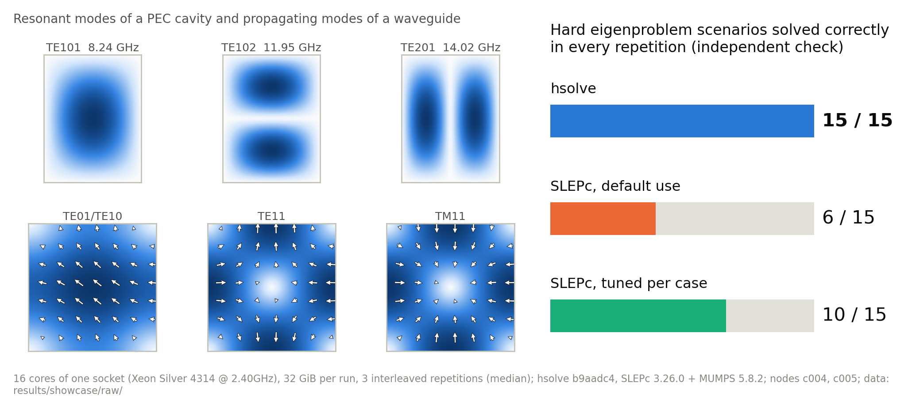
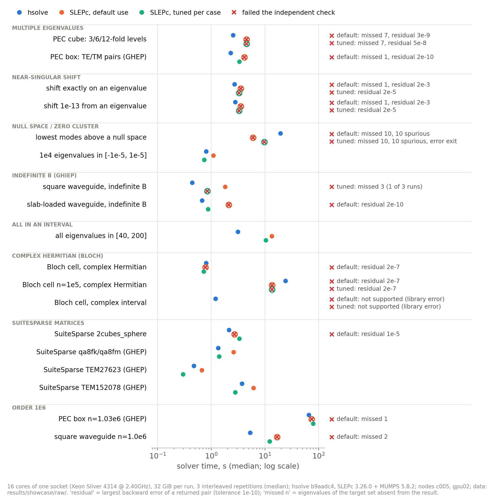
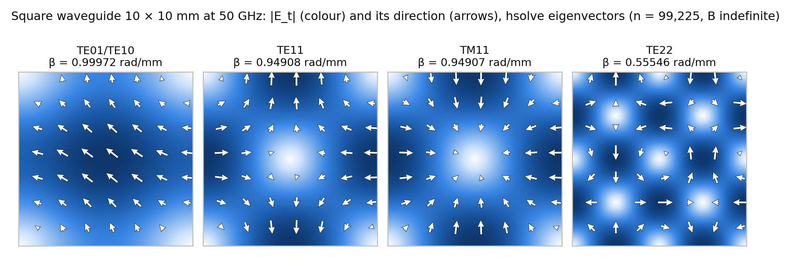

# hsolve：电磁仿真大规模非正定厄密特征值求解，一个不漏、给出证明

[](LICENSE)
[](https://github.com/seuclkzsd/hsolve/actions/workflows/ci.yml)
[](https://github.com/seuclkzsd/hsolve/releases)
[](https://seuclkzsd.github.io/hsolve/)

[文档站](https://seuclkzsd.github.io/hsolve/) · [演示视频](https://www.bilibili.com/video/BV1RCn76bEPP/) · [下载 Release](https://github.com/seuclkzsd/hsolve/releases) · [English](README.en.md)



谐振腔、波导、光子晶体经有限元离散后，是稀疏厄密特征值问题 A x = λ B x：A 不定，波导问题里 B 也不定，而工程上
只要目标频率附近的十几个模。常用的位移反演 Krylov 方法遇到重特征值（简并模）、零空间或近奇异位移时会漏模，有时还
照样报告成功：PEC 立方腔（n = 92,256）求 21 个特征值、目标集里有 3、6、12 重的简并级时，SLEPc 按常规用法 3 次运行
每次都返回 21 个特征对，却都漏掉其中 7 个；百万阶的长方腔与方波导上，SLEPc 按常规用法有 4 次运行报告成功、结果却缺了目标集里的
特征值。hsolve 在目标窗口两端做 Sylvester 惯性计数，
核对「应该有几个」与「找到了几个」，缺了就补求；B 正定时，结果附带一份可以复核的完备性证书。

## 核心能力一览

| 能力 | 已经做到 | 证据 |
|---|---|---|
| 不漏解 | B 正定（含 B = I）时用惯性计数证明目标窗口内的特征值全部找到，报告写明证明方法与失败概率上界。18 个困难场景中，hsolve 每个场景每次都正确（18/18），SLEPc 常规用法 6/18、逐例调优 12/18 | [算法原理](docs/guide/algorithms.md) · [困难场景对比](docs/showcase/困难场景对比.md) |
| 速度 | 两者都正确的 12 个场景中，对逐例调优的 SLEPc：6 个快 1.05–3.30 倍，1 个相当，5 个慢（速度为对方的 0.63–0.92：两个复厄密问题、两个 SuiteSparse 棱元广义问题、零附近 1e4 个特征值）；对常规用法快 1.37–4.29 倍。hsolve 的时间含完备性证书 | [困难场景对比](docs/showcase/困难场景对比.md#时间) |
| 规模与内存 | 十万阶三维广义问题 2.29 s、峰值内存 0.75 GiB；百万阶 65.7 s、11.5 GiB；百万阶 B 不定方波导 5.31 s、1.91 GiB。内存预算自动由 cgroup / ulimit / 物理内存推出，放不下时转外存 | [资源需求](docs/INSTALL.md#5-资源需求) |
| 问题覆盖 | HEP、GHEP、GHIEP（B 不定的波导）；实对称与复厄密；σ 附近最近 k 个、区间内全部、代数两端 | [求解边界](docs/SOLUTION.md#12-求解边界能处理--不能处理) |
| 正确性复核 | 独立评测器由原矩阵重算后向误差、特征值误差与子空间夹角，并按参考谱检查漏解与虚报。上述 54 次 hsolve 运行全部通过，最大后向误差 7.5e-11（容差 1e-10）；谐振腔频率与离散精确值的相对差 ≤ 3.1e-14 | [评测方法](docs/guide/evaluation.md) |
| 并行 | OpenMP 多线程；多 socket 机器上每 socket 一个进程（`hsolve-mpi`）；可选的 cuBLAS 卸载；没有 MPI 与 GPU 时走默认的单进程 CPU 路径，开启时证书的条件与保证不变 | [并行方案](docs/PARALLEL.md) |
| 开源治理 | Apache-2.0；构建与默认运行只依赖开源组件，逐项登记（可选的 GPU 卸载在运行时加载用户已安装的 CUDA 库，NVIDIA 许可，不随包分发）；CI、带 SHA256SUMS 的 Release；贡献、治理与安全策略 | [NOTICE](NOTICE) · [CONTRIBUTING](CONTRIBUTING.md) · [GOVERNANCE](GOVERNANCE.md) |

测试条件：Intel Xeon Silver 4314 节点（2 × 16 核），每次运行绑定一个 socket 的 16 个物理核、内存上限 32 GiB，同一时刻
只有一个计时运行；hsolve 求解器源码提交 b9aadc4，SLEPc/PETSc 3.26.0 + MUMPS 5.8.2；每个场景 3 次交错重复，取中位数。
原始记录在 [`results/showcase/`](results/showcase/)，表格与图由 [`tools/showcase/`](tools/showcase/) 生成。

## 快速开始

用容器镜像，不需要编译（内置样例：求解 → 独立评测 → 打印结果表）：

```bash
docker run --rm ghcr.io/seuclkzsd/hsolve:1.0.0 demo
```

或者下载可移植的二进制包，求解自己的矩阵：

```bash
curl -LO https://github.com/seuclkzsd/hsolve/releases/download/v1.0.0/hsolve-1.0.0-linux-x86_64.tar.gz
tar -xzf hsolve-1.0.0-linux-x86_64.tar.gz && cd hsolve-1.0.0-linux-x86_64
./bin/hsolve --A A.npz --B B.npz --sigma 0.5 --k 10 --out out/     # σ = 0.5 附近最近的 10 个特征对
```

结果在 `out/`：`eigenvalues.npy`、`eigenvectors.npy` 与 `report.json`（残差、完备性证书、各阶段计时、峰值内存）。
从源码构建（Linux x86-64，conda-forge，三条命令）与 Python 接口见[快速开始](docs/guide/quickstart.md)：

```python
import hsolve
res = hsolve.solve(A, B, sigma=0.5, k=10)      # A、B：SciPy 稀疏矩阵、NumPy 数组或矩阵文件
print(res.success, res.eigenvalues, res.report["certificate"]["statement"])
```

## 功能

- **完备性证书**：`exact`（双精度 Sylvester 计数，默认）、`randomized`（在已有分解上的随机排除检验，失败概率上界默认
  1e-12）、`auto`（按实测代价选能认证的最便宜者）；缺对时自动收缩重跑。
- **不定问题**：对称不定 LDLᵀ（MUMPS 5.8.2，随仓库附带官方源码包并打补丁）；B 不定的波导问题自动识别，零空间自动排除。
- **谱切片**：区间目标按惯性计数切片，每片单独认证，特征值个数没有上限；代数最小 / 最大的 k 个。
- **稳健**：σ 落在特征值上或密集簇中、零附近密集谱、近奇异位移、内存受限都有对应的处置；非厄密输入直接拒绝。
- **速度**：自研多线程嵌套剖分（带分隔子的流精修）、块 Krylov-Schur 的多右端回代、MUMPS 回代的 AVX-512 / AVX2 窄核。
- **接口**：命令行（`.npz` / `.npy` / `.mtx` 进，`.npy` 与 JSON 报告出）与 Python（SciPy / NumPy 进出），同一份配置格式。
- **可复现**：确定性模式下，同一线程数的分解与回代逐位可复现；所有运行可用独立评测器 `tools/eval` 复核。

## 困难场景对比

同样 16 核、32 GiB 下，hsolve 与 SLEPc（Krylov-Schur + 位移反演 + MUMPS）各求解 3 次，每次结果都由与求解器无关的
评测程序 `tools/eval` 判定（后向误差 ≤ 1e-10，对照参考谱检查漏解）。「常规用法」是 SLEPc 与 MUMPS 的默认参数，
「逐例调优」是用同一调优程序为每个算例搜出的最快有效配置。下表摘出 8 个场景，全部 18 个见
[困难场景对比](docs/showcase/困难场景对比.md)：

| 场景 | 算例 | hsolve | SLEPc 常规用法 | SLEPc 逐例调优 |
|---|---|---|---|---|
| 重特征值：PEC 立方腔：目标集含 3、6、12 重特征值 | n = 92,256，HEP | 正确 3/3，2.55 s | **错误** 0/3：漏解 7 个、残差超限（最大 2.0e-08） | **错误** 2/3：残差超限（最大 3.5e-09） |
| 近奇异位移：位移 σ 恰为特征值（K = A − σB 奇异） | n = 109,744，GHEP | 正确 3/3，2.84 s | **错误** 0/3：漏解 1 个、残差超限（最大 1.8e-03） | **错误** 0/3：残差超限（最大 3.6e-06） |
| 零附近密集谱 / 低频击穿：PEC 腔 σ = 0：最低 k 个物理谐振（梯度零空间 35475 维） | n = 109,744，GHEP | 正确 3/3，19.4 s | **错误** 0/3：返回零空间模 10 个 | **错误** 0/3：返回零空间模 10 个、报错退出 |
| 不定 B 的广义问题：方波导 10 × 10 mm、50 GHz：18 个传播模 | n = 99,225，GHIEP | 正确 3/3，0.442 s | 正确 3/3，1.81 s | **错误** 2/3：漏解 3 个 |
| 区间内全部特征值：PEC 长方腔区间 [40, 200] 内全部特征值（约 500 个，二重） | n = 109,744，GHEP | 正确 3/3，3.14 s | 正确 3/3，13.5 s | 正确 3/3，10.4 s |
| 复厄密（Bloch 周期）：Bloch 周期单元：区间内全部特征值（复厄密） | n = 10,080，HEP，复数 | 正确 3/3，1.2 s | **不支持**（PETSc 报错） | **不支持**（PETSc 报错） |
| SuiteSparse 实际矩阵：2cubes_sphere（电磁有限元，n = 101492） | n = 101,492，HEP | 正确 3/3，2.14 s | **错误** 0/3：残差超限（最大 1.3e-05） | 正确 3/3，2.15 s |
| 百万阶：PEC 长方腔 n = 1027733（广义问题） | n = 1,027,733，GHEP | 正确 3/3，65.7 s | **错误** 0/3：漏解 1 个 | 正确 3/3，79.3 s |



## 物理示例

### 方波导的 18 个传播模（B 不定）

10 mm × 10 mm 的空心金属方波导，在 50 GHz 下有 18 个传播模（TE 12 个、TM 6 个，截止频率 15·√(m² + n²) GHz）。
用仓库里的有限元生成器离散（Lee–Sun–Cendes 棱元-节点元混合公式，λ = −β²），这是一个 B 不定、且带大维零空间的
广义问题：

```bash
python -m tools.gen.waveguide --family waveguide --a 10 --b 10 --freq 50 --target-n 20000 --name wg-square-2e4
hsolve --A data/cases/wg-square-2e4/A.npz --B data/cases/wg-square-2e4/B.npz --sigma -0.5 --k 18 --out out/
```

hsolve 自动识别 B 不定并排除零空间，返回的正是 18 个传播模。B 不定时 Sylvester 惯性不能计数，所以这个问题没有
完备性证书（`report.json` 的 `certificate` 写明不可用），结果靠每个特征对的残差验收以及与参考解的对照来核对。
在 n ≈ 1e5 与 1e6 两档网格上，18 个传播模全部找到、没有伪模；hsolve 的传播常数与同一离散问题的精确值相对差不超过
1.5e-12 / 7.7e-12，与解析解 β = √(k₀² − k_c²) 的差（网格离散误差）从 1.48e-3 降到 1.48e-4，按 h² 下降——精度瓶颈在
网格，不在求解器。百万阶这一档 16 核求解 5.31 s。



### 矩形谐振腔（B 正定，带完备性证书）

WR-90 截面（22.86 × 10.16 mm）、长 30 mm 的金属腔，Yee 网格 46 × 20 × 60 离散，n = 155,966。旋度-旋度算子在 0 处
有 50,445 维的梯度零空间，σ = 0 附近的普通位移反演会收敛到这些非物理零模（低频击穿）。hsolve 用
`zero_filter_tol = 1e-8` 按惯性把零带整段排除，返回最低的 10 个物理谐振，exact 证书「应有 24 个、找到 24 个」通过，
二重简并的 TE111 / TM111 两个都在；最大后向误差 1.8e-12，独立评测通过。

| 模式 | 解析解 (GHz) | hsolve (GHz) | hsolve 对离散精确值 | 网格离散误差 |
|---|---|---|---|---|
| TE101 | 8.243877 | 8.242518 | 3.1e-14 | 0.02% |
| TE102 | 11.952313 | 11.947797 | 1.5e-14 | 0.04% |
| TE201 | 14.033880 | 14.024152 | 9.3e-15 | 0.07% |
| TE111 / TM111（二重） | 16.900569 | 16.886670 | 1.5e-14 | 0.08% |

全部 10 个模式、模式场图与复现命令（`tools/showcase/run_all.sh physics`）见[物理场景](docs/showcase/物理场景.md)。

## 并行方案

| 层 | 负责的计算 | 实测 |
|---|---|---|
| 多线程（OpenMP） | 全部数值计算：排序、MUMPS 分解与回代、稀疏核、正交化 | 1 → 16 线程：三维 1e5 问题 3.6–4.5 倍，二维与复数问题 2.3–2.7 倍（[P9 记录](results/p9_measurements.md) §5） |
| 多进程（`hsolve-mpirun`） | 每个 socket 一个 helper 进程：证书的两次计数同时做，谱切片分给各 socket | 两 socket（8 + 8 核）对同样核上的单进程：百万阶 1.09–1.11 倍，多切片区间 1.15–1.74 倍；单 socket 上不划算，不默认开启（[P10 记录](results/p10_mpi.md)） |
| GPU（`--gpu auto`） | 百万阶分解中的大稠密更新（FP64 cuBLAS，运行时加载） | 一块 V100：百万阶整次运行 1.06–1.07 倍；5e5 阶以下不卸载，与 CPU 路径相同（[P10 记录](results/p10_gpu.md)） |

没有 MPI、没有 GPU 时，单进程 CPU 路径就是默认路径。多进程与 GPU 卸载不改变完备性证书的成立条件与保证，结果照常经
残差验收。开发阶段 P10 的实测中，多进程模式的惯性计数与谱切片和单进程相同（双路 Xeon Silver 4314，16 核，每次运行
经独立评测，[P10 多进程记录](results/p10_mpi.md)）；GPU 卸载与 CPU 路径的特征值相对差不超过 3.3e-15（一块 Tesla
V100 与 16 核，两个百万阶测例各 5 次运行，[P10 GPU 记录](results/p10_gpu.md) §5）。详见[并行方案](docs/PARALLEL.md)。

## 文档

| 文档 | 内容 |
|---|---|
| [快速开始](docs/guide/quickstart.md) | 安装与第一次求解 |
| [命令行](docs/guide/cli.md) · [Python 接口](docs/PYTHON.md) · [配置与输出格式](docs/FORMATS.md) | 用法与全部选项、配置键、报告字段 |
| [结果解读与诊断](docs/guide/diagnostics.md) | 证书的各种状态、时间与内存、常见现象的处置 |
| [算法原理概览](docs/guide/algorithms.md) · [方案说明](docs/SOLUTION.md) | 原理、复杂度、收敛性、故障场景与安全设计 |
| [评测方法](docs/guide/evaluation.md) · [研发记录](docs/guide/history.md) | 怎样得到每个数字；各阶段的测量报告 |
| [设计文档](docs/DESIGN.md) · [开发与测试](docs/guide/developing.md) | 模块契约、构建、测试与测量纪律 |

全部文档的索引：[docs/README.md](docs/README.md)；带搜索的文档站：<https://seuclkzsd.github.io/hsolve/>。

## 路线图

- **2026Q4**：1.0 正式版本；1.1 合入极端压力输入上的残差修正改进，并把对 MUMPS 的补丁与发现的问题反馈给上游。
- **2027Q1**：PyPI 与 conda-forge 发布；aarch64（鲲鹏 + openEuler）与不带 AVX-512 的平台；降低证书代价。
- **2027Q2**：原生复厄密 LDLᴴ；与 MFEM、NGSolve、Elmer 对接的示例。
- **2027Q3–Q4**：跨节点的分布式谱切片；因子常驻 GPU 的路径。

每项的衡量标准与「不做什么」见 [ROADMAP.md](ROADMAP.md)，版本历史见 [CHANGELOG.md](CHANGELOG.md)。

## 参与贡献

欢迎代码、文档，以及**电磁测试矩阵**和验证报告——真实工程矩阵是检验求解器最好的材料，不写代码也能贡献。
开发环境三条命令即可搭好，提交前的检查与 CI 相同，见 [CONTRIBUTING.md](CONTRIBUTING.md)；参与者须遵守
[行为准则](CODE_OF_CONDUCT.md)，安全问题请按 [SECURITY.md](SECURITY.md) 私下报告。维护者与决策规则见
[MAINTAINERS.md](MAINTAINERS.md) 与 [GOVERNANCE.md](GOVERNANCE.md)。

## 引用

如果你在研究或工程报告中使用了 hsolve，请按 [CITATION.cff](CITATION.cff) 引用（GitHub 页面右侧的「Cite this repository」）：

```bibtex
@software{hsolve,
  author  = {seuclkzsd},
  title   = {hsolve: a certified shift-invert eigensolver for large sparse Hermitian (indefinite) eigenproblems from electromagnetic simulation},
  year    = {2026},
  version = {1.0.0},
  url     = {https://github.com/seuclkzsd/hsolve},
  license = {Apache-2.0}
}
```

## 许可证

hsolve 以 [Apache License 2.0](LICENSE) 发布。仓库附带的 MUMPS 5.8.2 官方源码包及我们对它的补丁（`patches/`）适用
CeCILL-C；其它第三方组件的许可证与分发方式见 [NOTICE](NOTICE) 与 [THIRD_PARTY_NOTICES](THIRD_PARTY_NOTICES)。

## 项目背景

hsolve 起源于 2026 上海开源软件应用创新大赛（主办：开源中国）的中国商飞企业命题「非正定厄密稀疏矩阵特征值求解」，
命题与规则见主办方网站 <https://www.oschina.net/os2026/>。

## 局限与后续工作

- B 不定（GHIEP）时 Sylvester 惯性不能计数：没有完备性证书（报告中注明），且只支持「σ 附近最近 k 个」目标。
- 只求解厄密问题；非厄密输入（如复对称的 PML）直接拒绝。
- 复厄密矩阵经 2n 阶实对称嵌入分解，内存与运算量与复数 LU 相当、高于原生 LDLᴴ（路线图 2027Q2）。
- 证书每轮需要两次额外的分解：在 hsolve 慢于逐例调优 SLEPc 的 5 个场景里，证书占 hsolve 时间的 17–57%；复厄密
  问题还要经 2n 阶实嵌入分解（见上一条），Bloch 周期单元 n ≈ 1e5 时速度为调优 SLEPc 的 0.65。
- 已验证的平台是 Linux x86-64；BLAS hook 的 SIMD 内核针对 AVX-512 / AVX2，其它 CPU 走可移植路径（aarch64 验证见路线图 2027Q1）。
- 单节点共享内存求解；跨节点的分布式求解尚未支持（路线图 2027Q3）。GPU 卸载只覆盖分解中的大稠密更新，收益限于百万阶问题。
- 结构识别快速路径（可分离 / Bloch 周期的 curl-curl 候选）默认关闭，上文的数字都不依赖它。
- 在人工构造的极端压力输入上（3–25 重的特征值簇与位移相距 2⁻²²–2⁻³²，矩阵尺度 2^±16），残差修正有时达不到 1e-10 的
  后向误差或补算不全：开发阶段 P34 的 60 个此类输入中 1.0 的求解器通过 27 个，其余 33 个都明确报告失败（32 个
  `success = false`，1 个超过 30 s 时限），没有一个报告成功而结果有误。改进已在原型中通过全部 60 个输入，计划在 1.1
  合入（[P34 记录](results/p34_measurements.md)）。
