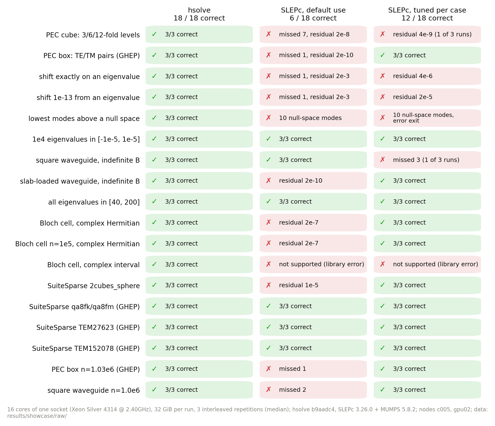
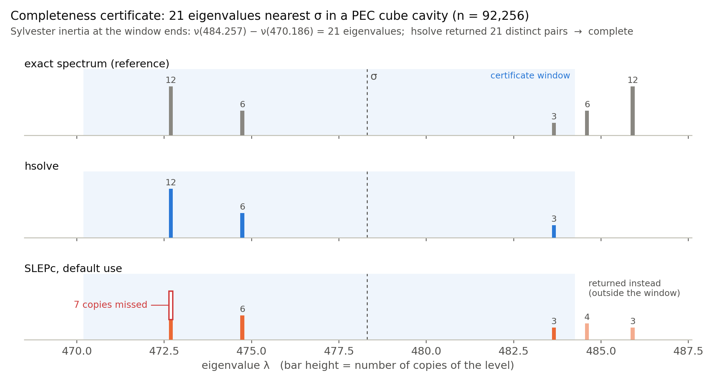
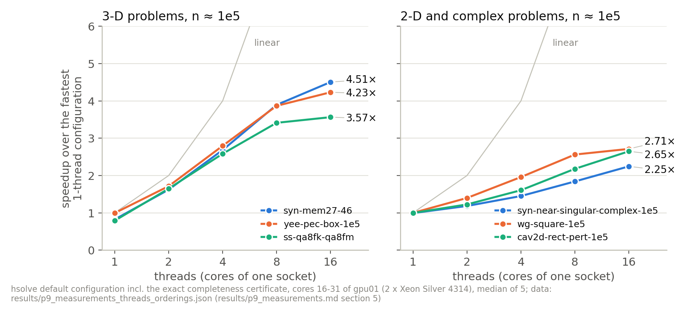

# 困难场景对比：hsolve 与 SLEPc

电磁仿真里的特征值问题，难点往往不在规模，而在谱的形状：重特征值、位移恰好落在特征值上、旋度-旋度算子
在 0 处的巨大零空间、B 不定的波导问题、需要一个不漏的整段区间、复厄密的周期结构。本页把这些场景逐一做成
可复现的算例，让 hsolve 与开源标杆 SLEPc（Krylov-Schur + 位移反演 + MUMPS）在同型号节点、同样 16 核与 32 GiB
下求解，每一次结果都交给与求解器无关的评测程序判定对错。SLEPc 按两种方式使用：典型用户的**常规用法**，以及
为每个算例单独调过参数的**逐例调优**。物理量（谐振频率、传播常数）与解析解的对照见[物理场景](物理场景.md)。


## 结论

<!-- BEGIN GENERATED: headline -->
- 15 个困难场景、共 135 次求解运行，全部由独立评测程序 `tools/eval` 判定。所有重复都通过评测的场景数：hsolve **15/15**，SLEPc 常规用法 **6/15**，SLEPc 逐例调优 **10/15**。
- SLEPc 常规用法未通过的场景：漏解 7 个、残差超限（最大 5.8e-08）（1 个：PEC 立方腔：目标集含 3、6、12 重特征值）；漏解 1 个、残差超限（最大 1.6e-10）（1 个：PEC 长方腔：TE/TM 二重简并（广义问题））；漏解 1 个、残差超限（最大 1.8e-03）（2 个：位移 σ 恰为特征值（K = A − σB 奇异）、位移 σ 距特征值 1e-13（相对））；漏解 10 个、伪特征值 10 个（1 个：PEC 腔 σ = 0：最低 k 个物理谐振（梯度零空间 35475 维））；残差超限（最大 1.8e-10）（1 个：半填充介质波导（εr = 2.25）：28 个传播模）；残差超限（最大 1.3e-05）（1 个：2cubes_sphere（电磁有限元，n = 101492））；漏解 1 个（1 个：PEC 长方腔 n = 1027733（广义问题））；漏解 2 个（1 个：方波导 n = 998001（不定 B））。
- SLEPc 逐例调优未通过的场景：漏解 7 个、残差超限（最大 1.1e-08）（1 个：PEC 立方腔：目标集含 3、6、12 重特征值）；残差超限（最大 3.0e-05）（1 个：位移 σ 恰为特征值（K = A − σB 奇异））；残差超限（最大 5.0e-05）（1 个：位移 σ 距特征值 1e-13（相对））；漏解 10 个、伪特征值 10 个（1 个：PEC 腔 σ = 0：最低 k 个物理谐振（梯度零空间 35475 维））；残差超限（最大 1.3e-05）（1 个：2cubes_sphere（电磁有限元，n = 101492））。
- 两者都正确的 10 个场景中，hsolve 对SLEPc 逐例调优的中位时间比：10 个更快（1.11–3.27×）。
- 两者都正确的 6 个场景中，hsolve 对SLEPc 常规用法的中位时间比：6 个更快（1.41–4.26×）。
- hsolve 在 B 正定的 12 个场景里每次都附带 Sylvester 惯性完备性证书：36/36 次证书通过；结构识别快速路径在全部运行中关闭（报告 `candidate_source` 均为 `iterative`）。
<!-- END GENERATED: headline -->



## 测试条件

<!-- BEGIN GENERATED: conditions -->
- 硬件：c004, c005（Intel(R) Xeon(R) Silver 4314 CPU @ 2.40GHz，2 × 16 核，251 GB），每次运行绑定一个 socket 的 16 个物理核 `16-31`、内存上限 32 GiB，同一时刻只有一个计时运行（`tools/run/guard.py --exclusive`）。
- 版本：hsolve 源码提交 b9aadc4（`build/release/hsolve`，md5 8d69a98bc60e），SLEPc/PETSc 3.26.0（MUMPS 5.8.2）；日期 2026-10-22 至 2026-10-22。
- 重复：每个场景 3 次，三个求解器交错运行（每次轮换先后顺序），表中时间为中位数。
- 时间口径：hsolve 为报告中的 `time_total_s`（含范数估计、分析、分解、迭代、完备性证书）；SLEPc 为 `-log_view` 的 setup + solve + 特征向量计算（含 MUMPS 分析与分解）。两者都不含进程启动和读写文件。内存为求解阶段的峰值（hsolve `peak_rss_bytes`，SLEPc 各 rank VmHWM 之和）。
<!-- END GENERATED: conditions -->

## 方法

**三个求解器**（每个场景内交错运行，每次重复轮换先后顺序）：

- **hsolve**：命令行 `build/release/hsolve`，算例自带的配置（目标、容差 1e-10），完备性证书为默认的 `exact`。
  结构识别快速路径（可分离笛卡尔 / Bloch 旋度-旋度候选，`src/eigen/separable_*`）在全部运行中关闭：B 正定的问题
  加配置 `"method": "shift_invert_lanczos"`——这正是默认 `auto` 在 B 正定时选用的方法，唯一的区别是跳过结构候选
  （`src/driver/definite.cpp` 只在 `auto` 时尝试它）；每次运行都检查报告里的 `candidate_source` 为 `iterative`。
  B 不定（GHIEP）的问题没有这条路径，配置不变。「最低 k 个物理模」场景另加 `zero_filter_tol = 1e-8`
  （按惯性排除零空间，`docs/FORMATS.md` §2）。
- **SLEPc 常规用法**：`tools/bench/baseline_slepc.py`，Krylov-Schur + 位移反演，K = A − σB 用 MUMPS 分解
  （实数 LDLᵀ，复数 LU），SLEPc 与 MUMPS 的默认参数，1 个 MPI 进程 × 16 个 OpenMP 线程，收敛判据与 hsolve 相同
  （后向误差 ≤ 1e-10）。
- **SLEPc 逐例调优**：`tools/bench/tune_slepc.py` 为每个算例在 16 核上搜索出的最快有效配置（进程/线程布局、
  `ncv`、MUMPS 排序与 BLR 等），以及之后为修复其失败而收紧的配置，合并在
  [`results/showcase/slepc_tuned_profiles.json`](../../results/showcase/slepc_tuned_profiles.json)。
  没有为该算例调过的场景使用同类问题（问题类型 + 目标方式）的调优配置，表中注明。

**判定**（`tools/eval`，与求解器无关）：每个返回的特征对重新计算后向误差（保守的 2-范数估计），
与参考谱逐一匹配，检查是否漏掉了目标要求的特征值、是否有参考谱里不存在的特征值（伪特征值）、
是否有重复的特征向量。一次运行**有效**当且仅当：正常退出、求解器自称成功、评测通过。一个场景下某个求解器
**正确**当且仅当它的每一次重复都有效。参考谱的来源如下：

<!-- BEGIN GENERATED: scenario-list -->
| 场景 | 难点 | 参考解 |
|---|---|---|
| 重特征值：PEC 立方腔：目标集含 3、6、12 重特征值 | 立方体对称使 (m,n,p) 的排列给出逐位相等的特征值，单向量 Krylov 只能借舍入找到副本 | 离散精确谱（闭式公式，完整） |
| 重特征值：PEC 长方腔：TE/TM 二重简并（广义问题） | 每个 m,n,p ≥ 1 的谐振频率都是 TE/TM 二重，漏掉副本时残差仍然很小 | 离散精确谱（闭式公式，完整） |
| 近奇异位移：位移 σ 恰为特征值（K = A − σB 奇异） | σ 取精确特征值（与矩阵特征值只差装配舍入），位移矩阵数值奇异 | 离散精确谱（闭式公式，完整） |
| 近奇异位移：位移 σ 距特征值 1e-13（相对） | 位移矩阵的最小特征值比其范数小约 13 个数量级 | 离散精确谱（闭式公式，完整） |
| 零附近密集谱 / 低频击穿：PEC 腔 σ = 0：最低 k 个物理谐振（梯度零空间 35475 维） | 旋度-旋度算子的梯度零空间在 0 处形成巨大重特征值，σ ≈ 0 的位移反演收敛到非物理零模 | 离散精确谱（闭式公式，完整） |
| 零附近密集谱 / 低频击穿：零附近 1e4 个特征值挤在 [−1e−5, 1e−5] | 间距接近容差分辨率的密集簇，最近 21 个须逐一分辨 | 离散精确谱（闭式公式，完整） |
| 不定 B 的广义问题：方波导 50 GHz（赛题真实算例）：18 个传播模 | A、B 都不定（B 有 24649 个负特征值），A 有 24649 维零空间，TE/TM 模简并 | 数值参考（窗口内完整，惯性计数认证） |
| 不定 B 的广义问题：半填充介质波导（εr = 2.25）：28 个传播模 | 不定 B，消逝谱中有复共轭特征值对，LSE/LSM 模混合 | 数值参考（ARPACK，不保证完整：只做一致性判定） |
| 区间内全部特征值：PEC 长方腔区间 [40, 200] 内全部特征值（约 500 个，二重） | 区间内数百个二重特征值，须一个不漏 | 离散精确谱（闭式公式，完整） |
| SuiteSparse 实际矩阵：2cubes_sphere（电磁有限元，n = 101492） | 实际电磁有限元矩阵，内部位移使 A − σI 不定 | 数值参考（ARPACK，不保证完整：只做一致性判定） |
| SuiteSparse 实际矩阵：qa8fk/qa8fm（三维声学刚度/质量，GHEP） | 实际有限元广义问题，谱较密 | 数值参考（ARPACK，不保证完整：只做一致性判定） |
| SuiteSparse 实际矩阵：TEM27623（Nédélec 旋度-旋度/质量，GHEP） | 实际三维电磁旋度-旋度矩阵，含梯度零空间，量级 1e13 | 数值参考（ARPACK，不保证完整：只做一致性判定） |
| SuiteSparse 实际矩阵：TEM152078（Nédélec 旋度-旋度/质量，n = 152078） | 同上，规模 1.5e5 | 数值参考（ARPACK，不保证完整：只做一致性判定） |
| 百万阶：PEC 长方腔 n = 1027733（广义问题） | 百万阶三维问题，二重简并 | 离散精确谱（闭式公式，完整） |
| 百万阶：方波导 n = 998001（不定 B） | 百万阶不定广义问题，249001 维零空间 | 数值参考（窗口内完整，惯性计数认证） |
<!-- END GENERATED: scenario-list -->

「离散精确谱」由 Yee 网格的闭式色散关系或构造性合成得到，列出全部特征值。方波导的参考由 TE/TM 两族对称正定
子问题分别计数（SuperLU 对称 LDLᵀ 的 Sylvester 惯性）并计算得到，与求解器无关，窗口内完整
（`tools/showcase/waveguide_ref.py`）。「最低 k 个物理模」场景的参考谱是去掉梯度零空间（特征值 0）之后的
物理谱，因此返回零空间向量会被判为伪特征值。

## 结果

每格：是否正确（有效次数 / 重复次数）、未通过的类别，求解时间中位数与求解阶段峰值内存。

<!-- BEGIN GENERATED: scenario-table -->
| 场景 | 算例 | 目标 | hsolve | SLEPc 常规用法 | SLEPc 逐例调优 |
|---|---|---|---|---|---|
| 重特征值：PEC 立方腔：目标集含 3、6、12 重特征值 | `yee-pec-cube-32`<br>n = 92,256，HEP | σ = 478.3019633，k = 21，含 3/6/12 重 | **正确** 3/3<br>3.79 s · 1.13 GiB | **错误** 0/3：漏解 7 个、残差超限（最大 5.8e-08）<br>4.55 s · 0.79 GiB | **错误** 0/3：漏解 7 个、残差超限（最大 1.1e-08）<br>4.53 s · 0.79 GiB |
| 重特征值：PEC 长方腔：TE/TM 二重简并（广义问题） | `yee-pec-box-1e5`<br>n = 109,744，GHEP | σ = 52.85030307，k = 10，含 2 重 | **正确** 3/3<br>2.29 s · 0.79 GiB | **错误** 0/3：漏解 1 个、残差超限（最大 1.6e-10）<br>4.1 s · 0.87 GiB | **正确** 3/3<br>3.35 s · 1.34 GiB |
| 近奇异位移：位移 σ 恰为特征值（K = A − σB 奇异） | `yee-pec-box-1e5`<br>n = 109,744，GHEP | σ = 50.12059816，k = 10，含 2 重 | **正确** 3/3<br>2.86 s · 0.98 GiB | **错误** 0/3：漏解 1 个、残差超限（最大 1.8e-03）<br>3.53 s · 0.86 GiB | **错误** 0/3：残差超限（最大 3.0e-05）<br>3.57 s · 1.35 GiB |
| 近奇异位移：位移 σ 距特征值 1e-13（相对） | `yee-pec-box-1e5`<br>n = 109,744，GHEP | σ = 50.12059816，k = 10，含 2 重 | **正确** 3/3<br>2.81 s · 1.00 GiB | **错误** 0/3：漏解 1 个、残差超限（最大 1.8e-03）<br>3.53 s · 0.87 GiB | **错误** 0/3：残差超限（最大 5.0e-05）<br>3.59 s · 1.33 GiB |
| 零附近密集谱 / 低频击穿：PEC 腔 σ = 0：最低 k 个物理谐振（梯度零空间 35475 维） | `sc-pec-box-1e5-physical`<br>n = 109,744，GHEP | σ = 0，k = 10，含 2 重 | **正确** 3/3<br>66.6 s · 1.03 GiB | **错误** 0/3：漏解 10 个、伪特征值 10 个<br>8.62 s · 0.85 GiB | **错误** 0/3：漏解 10 个、伪特征值 10 个<br>11 s · 1.28 GiB |
| 零附近密集谱 / 低频击穿：零附近 1e4 个特征值挤在 [−1e−5, 1e−5] | `syn-zero-cluster-real-1e5`<br>n = 100,000，HEP | σ = 0，k = 21 | **正确** 3/3<br>0.996 s · 0.27 GiB | **正确** 3/3<br>2.35 s · 0.26 GiB | **正确** 3/3<br>2.01 s · 0.26 GiB |
| 不定 B 的广义问题：方波导 50 GHz（赛题真实算例）：18 个传播模 | `wg-square-1e5`<br>n = 99,225，GHIEP | σ = -0.527231264，k = 18 | **正确** 3/3<br>0.431 s · 0.30 GiB | **正确** 3/3<br>1.75 s · 0.33 GiB | **正确** 3/3<br>0.902 s · 1.92 GiB |
| 不定 B 的广义问题：半填充介质波导（εr = 2.25）：28 个传播模 | `wg-halfslab-1e5`<br>n = 99,225，GHIEP | σ = -1.144438215，k = 28 | **正确** 3/3<br>0.674 s · 0.33 GiB | **错误** 0/3：残差超限（最大 1.8e-10）<br>2.13 s · 0.39 GiB | **正确** 3/3<br>1.3 s · 1.94 GiB |
| 区间内全部特征值：PEC 长方腔区间 [40, 200] 内全部特征值（约 500 个，二重） | `yee-pec-box-1e5`<br>n = 109,744，GHEP | 区间 [40, 200] | **正确** 3/3<br>3.15 s · 1.29 GiB | **正确** 3/3<br>13.4 s · 1.41 GiB | **正确** 3/3<br>10.3 s · 1.74 GiB |
| SuiteSparse 实际矩阵：2cubes_sphere（电磁有限元，n = 101492） | `ss-2cubes_sphere`<br>n = 101,492，HEP | σ = 283812833.1，k = 10 | **正确** 3/3<br>2.15 s · 0.73 GiB | **错误** 0/3：残差超限（最大 1.3e-05）<br>2.73 s · 0.78 GiB | **错误** 0/3：残差超限（最大 1.3e-05）<br>2.7 s · 0.79 GiB |
| SuiteSparse 实际矩阵：qa8fk/qa8fm（三维声学刚度/质量，GHEP） | `ss-qa8fk-qa8fm`<br>n = 66,127，GHEP | σ = 12.82327741，k = 10 | **正确** 3/3<br>1.33 s · 0.54 GiB | **正确** 3/3<br>2.61 s · 0.69 GiB | **正确** 3/3<br>1.48 s · 1.43 GiB |
| SuiteSparse 实际矩阵：TEM27623（Nédélec 旋度-旋度/质量，GHEP） | `ss-tem27623`<br>n = 27,623，GHEP | σ = 5.890158697e+13，k = 10 | **正确** 3/3<br>0.473 s · 0.23 GiB | **正确** 3/3<br>0.666 s · 0.28 GiB | **正确** 3/3<br>0.561 s · 0.54 GiB |
| SuiteSparse 实际矩阵：TEM152078（Nédélec 旋度-旋度/质量，n = 152078） | `ss-tem152078`<br>n = 152,078，GHEP | σ = 1.703946018e+14，k = 10 | **正确** 3/3<br>3.76 s · 1.26 GiB | **正确** 3/3<br>6.16 s · 1.22 GiB | **正确** 3/3<br>4.61 s · 1.77 GiB |
| 百万阶：PEC 长方腔 n = 1027733（广义问题） | `yee-pec-box-1e6`<br>n = 1,027,733，GHEP | σ = 52.89888488，k = 10，含 2 重 | **正确** 3/3<br>65.7 s · 11.4 GiB | **错误** 0/3：漏解 1 个<br>75 s · 12.2 GiB | **正确** 3/3<br>84.7 s · 15.9 GiB |
| 百万阶：方波导 n = 998001（不定 B） | `wg-square-1e6`<br>n = 998,001，GHIEP | σ = -0.5274894215，k = 18 | **正确** 3/3<br>5.3 s · 1.92 GiB | **错误** 0/3：漏解 2 个<br>16.3 s · 1.87 GiB | **正确** 3/3<br>12.1 s · 4.71 GiB |

全部重复均通过独立评测的场景数：hsolve 15/15，SLEPc 常规用法 6/15，SLEPc 逐例调优 10/15。
<!-- END GENERATED: scenario-table -->

### 时间

两者都正确时才给出时间比（> 1 表示 hsolve 更快）；方括号为各次重复的最小–最大值。

<!-- BEGIN GENERATED: speed-table -->
| 场景 | hsolve | SLEPc 常规用法 | SLEPc 逐例调优（配置来源） | 对常规用法 | 对逐例调优 |
|---|---|---|---|---|---|
| PEC 立方腔：目标集含 3、6、12 重特征值 | 3.79 s [2.55–3.93] | 4.55 s [4.5–4.57]（未全部通过） | 4.53 s [4.52–4.56]（未全部通过）<br>同类问题的调优配置（未针对该算例） | – | – |
| PEC 长方腔：TE/TM 二重简并（广义问题） | 2.29 s [2.27–2.29] | 4.1 s [4.09–4.16]（未全部通过） | 3.35 s [3.34–3.36]<br>该算例的调优配置 | – | 1.46× |
| 位移 σ 恰为特征值（K = A − σB 奇异） | 2.86 s [2.77–2.9] | 3.53 s [3.53–3.54]（未全部通过） | 3.57 s [3.32–3.61]（未全部通过）<br>该算例的调优配置 | – | – |
| 位移 σ 距特征值 1e-13（相对） | 2.81 s [2.73–2.85] | 3.53 s [3.52–3.53]（未全部通过） | 3.59 s [3.33–3.6]（未全部通过）<br>该算例的调优配置 | – | – |
| PEC 腔 σ = 0：最低 k 个物理谐振（梯度零空间 35475 维） | 66.6 s [25.3–76.6] | 8.62 s [7.26–14.2]（未全部通过） | 11 s [7.43–11.3]（未全部通过）<br>同类问题的调优配置（未针对该算例） | – | – |
| 零附近 1e4 个特征值挤在 [−1e−5, 1e−5] | 0.996 s [0.926–1.58] | 2.35 s [1.4–3.44] | 2.01 s [1.89–2.07]<br>同类问题的调优配置（未针对该算例） | 2.36× | 2.02× |
| 方波导 50 GHz（赛题真实算例）：18 个传播模 | 0.431 s [0.43–0.437] | 1.75 s [1.74–1.78] | 0.902 s [0.849–0.908]<br>该算例的调优配置 | 4.06× | 2.09× |
| 半填充介质波导（εr = 2.25）：28 个传播模 | 0.674 s [0.624–0.674] | 2.13 s [2.13–2.34]（未全部通过） | 1.3 s [1.23–1.32]<br>同类问题的调优配置（未针对该算例） | – | 1.93× |
| PEC 长方腔区间 [40, 200] 内全部特征值（约 500 个，二重） | 3.15 s [3.14–3.16] | 13.4 s [13.4–13.6] | 10.3 s [10.3–10.4]<br>该算例的调优配置 | 4.26× | 3.27× |
| 2cubes_sphere（电磁有限元，n = 101492） | 2.15 s [2.14–2.18] | 2.73 s [2.68–2.74]（未全部通过） | 2.7 s [2.69–2.71]（未全部通过）<br>同类问题的调优配置（未针对该算例） | – | – |
| qa8fk/qa8fm（三维声学刚度/质量，GHEP） | 1.33 s [1.33–1.34] | 2.61 s [2.61–2.61] | 1.48 s [1.45–1.55]<br>该算例的调优配置 | 1.95× | 1.11× |
| TEM27623（Nédélec 旋度-旋度/质量，GHEP） | 0.473 s [0.472–0.476] | 0.666 s [0.659–0.668] | 0.561 s [0.555–0.562]<br>同类问题的调优配置（未针对该算例） | 1.41× | 1.19× |
| TEM152078（Nédélec 旋度-旋度/质量，n = 152078） | 3.76 s [3.71–3.79] | 6.16 s [6.11–6.22] | 4.61 s [4.6–4.61]<br>同类问题的调优配置（未针对该算例） | 1.64× | 1.23× |
| PEC 长方腔 n = 1027733（广义问题） | 65.7 s [65.5–66] | 75 s [73.7–75.2]（未全部通过） | 84.7 s [84.6–84.9]<br>该算例的调优配置 | – | 1.29× |
| 方波导 n = 998001（不定 B） | 5.3 s [5.3–5.3] | 16.3 s [16.2–18]（未全部通过） | 12.1 s [11.9–12.3]<br>同类问题的调优配置（未针对该算例） | – | 2.27× |
<!-- END GENERATED: speed-table -->

### 未通过的运行

评测程序给出的原因与求解器 stderr 中的错误行（完整记录见 `results/showcase/raw/<场景>.json`）：

<!-- BEGIN GENERATED: failure-details -->
- **PEC 立方腔：目标集含 3、6、12 重特征值 / SLEPc 常规用法**（0/3 次有效）：5 of 21 pairs have backward error > tol=1e-10；6 of 21 pairs have backward error > tol=1e-10；completeness incomplete: 7 missing, boundary deficit 0, 21 distinct returned
- **PEC 立方腔：目标集含 3、6、12 重特征值 / SLEPc 逐例调优**（0/3 次有效）：4 of 21 pairs have backward error > tol=1e-10；6 of 21 pairs have backward error > tol=1e-10；7 of 21 pairs have backward error > tol=1e-10
- **PEC 长方腔：TE/TM 二重简并（广义问题） / SLEPc 常规用法**（0/3 次有效）：1 of 10 pairs have backward error > tol=1e-10；completeness incomplete: 1 missing, boundary deficit 0, 10 distinct returned；solver claims no success
- **位移 σ 恰为特征值（K = A − σB 奇异） / SLEPc 常规用法**（0/3 次有效）：9 of 10 pairs have backward error > tol=1e-10；completeness incomplete: 1 missing, boundary deficit 0, 10 distinct returned；solver claims no success
- **位移 σ 恰为特征值（K = A − σB 奇异） / SLEPc 逐例调优**（0/3 次有效）：9 of 10 pairs have backward error > tol=1e-10；solver claims no success
- **位移 σ 距特征值 1e-13（相对） / SLEPc 常规用法**（0/3 次有效）：9 of 10 pairs have backward error > tol=1e-10；completeness incomplete: 1 missing, boundary deficit 0, 10 distinct returned；solver claims no success
- **位移 σ 距特征值 1e-13（相对） / SLEPc 逐例调优**（0/3 次有效）：9 of 10 pairs have backward error > tol=1e-10；solver claims no success
- **PEC 腔 σ = 0：最低 k 个物理谐振（梯度零空间 35475 维） / SLEPc 常规用法**（0/3 次有效）：10 spurious eigenvalue(s) absent from the complete reference；completeness incomplete: 10 missing, boundary deficit 0, 10 distinct returned
- **PEC 腔 σ = 0：最低 k 个物理谐振（梯度零空间 35475 维） / SLEPc 逐例调优**（0/3 次有效）：10 spurious eigenvalue(s) absent from the complete reference；completeness incomplete: 10 missing, boundary deficit 0, 10 distinct returned
- **半填充介质波导（εr = 2.25）：28 个传播模 / SLEPc 常规用法**（0/3 次有效）：2 of 28 pairs have backward error > tol=1e-10；solver claims no success
- **2cubes_sphere（电磁有限元，n = 101492） / SLEPc 常规用法**（0/3 次有效）：5 of 10 pairs have backward error > tol=1e-10；solver claims no success
- **2cubes_sphere（电磁有限元，n = 101492） / SLEPc 逐例调优**（0/3 次有效）：5 of 10 pairs have backward error > tol=1e-10；solver claims no success
- **PEC 长方腔 n = 1027733（广义问题） / SLEPc 常规用法**（0/3 次有效）：completeness incomplete: 1 missing, boundary deficit 0, 10 distinct returned
- **方波导 n = 998001（不定 B） / SLEPc 常规用法**（0/3 次有效）：completeness incomplete: 2 missing, boundary deficit 0, 17 distinct returned；solver claims no success
<!-- END GENERATED: failure-details -->

### 完备性证书是什么

hsolve 对 B 正定的问题给出的不是「收敛了」，而是「这个窗口里一共有多少个特征值、我都找到了」：在窗口两端做
LDLᵀ 分解，由 Sylvester 惯性定律数出窗口内特征值的个数，与找到的互不相同的特征对个数比较。重特征值的
副本即使残差再小也逃不过这个计数。



### 多线程扩展

上面的时间都是 16 核。同一类十万阶问题从 1 线程到 16 线程的加速（相对于 1 线程下最快的配置，含完备性证书），
数据来自 P9 集成测量（[`results/p9_measurements.md`](../../results/p9_measurements.md) §5）：



## 复现

数据与表格全部由脚本生成：原始记录 `results/showcase/raw/*.json`（每次运行一条，失败的保留原因与 stderr），
汇总 [`results/showcase/scenarios.json`](../../results/showcase/scenarios.json) /
[`scenarios.md`](../../results/showcase/scenarios.md)，本页的表格区块由 `python -m tools.showcase.tables` 写入，
图由 `python3 -m tools.showcase.figures all` 生成。集群上的执行顺序（`tools/showcase/run_all.sh`）：

```bash
tools/dev/build.sh release                          # 构建（构建/测试道）
tools/showcase/run_all.sh prepare                   # 数据根：算例链接、派生算例、参考谱、目标
tools/showcase/run_all.sh profiles                  # 合并逐例调优的 SLEPc 配置
tools/showcase/run_all.sh slot1                     # 测量槽：每次一个 guard --exclusive 调用（≤ 2700 s）
tools/showcase/run_all.sh slot2
tools/showcase/run_all.sh slot3                     # n ≈ 1e6
tools/showcase/run_all.sh slot4                     # 复数算例（复数版 SLEPc）
tools/showcase/run_all.sh probe                     # 直接调用 SLEPc 的复厄密区间
python -m tools.showcase.tables                     # 汇总与本页表格
python3 -m tools.showcase.figures all               # 图（需要 matplotlib）
```

## 说明与局限

<!-- BEGIN GENERATED: limitations -->
对比只覆盖 SLEPc 的 Krylov-Schur + 位移反演 + MUMPS 这一条路线（电磁特征值问题最常用的开源组合），未测 SLEPc 的其他求解器（如围道积分 CISS、LOBPCG），也未测需要额外输入的用法（例如以离散梯度矩阵作`EPSSetDeflationSpace` 收缩零空间）。逐例调优只覆盖调优战役中出现过的算例，8 个场景（PEC 立方腔：目标集含 3、6、12 重特征值、PEC 腔 σ = 0：最低 k 个物理谐振（梯度零空间 35475 维）、零附近 1e4 个特征值挤在 [−1e−5, 1e−5]、半填充介质波导（εr = 2.25）：28 个传播模、2cubes_sphere（电磁有限元，n = 101492）、TEM27623（Nédélec 旋度-旋度/质量，GHEP）、TEM152078（Nédélec 旋度-旋度/质量，n = 152078）、方波导 n = 998001（不定 B））用的是同类问题的调优配置，没有专门为它们搜索参数。5 个场景（半填充介质波导（εr = 2.25）：28 个传播模、2cubes_sphere（电磁有限元，n = 101492）、qa8fk/qa8fm（三维声学刚度/质量，GHEP）、TEM27623（Nédélec 旋度-旋度/质量，GHEP）、TEM152078（Nédélec 旋度-旋度/质量，n = 152078））没有完整的参考谱，只用 ARPACK 参考做一致性判定，漏掉参考之外的特征值无法被发现。B 不定（GHIEP）时 Sylvester 计数给不出完备性证书，hsolve 在这类问题上的完整性由独立参考解验证，而不是由它自己证明。时间是同一型号节点（c004, c005，Intel(R) Xeon(R) Silver 4314 CPU @ 2.40GHz）上每个场景 3 次重复的中位数，换用其他硬件、核数或 MUMPS/BLAS 版本，时间比可能不同。
<!-- END GENERATED: limitations -->
