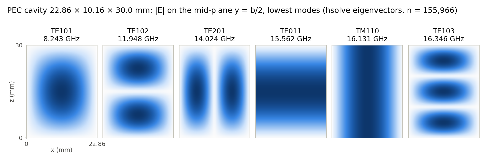
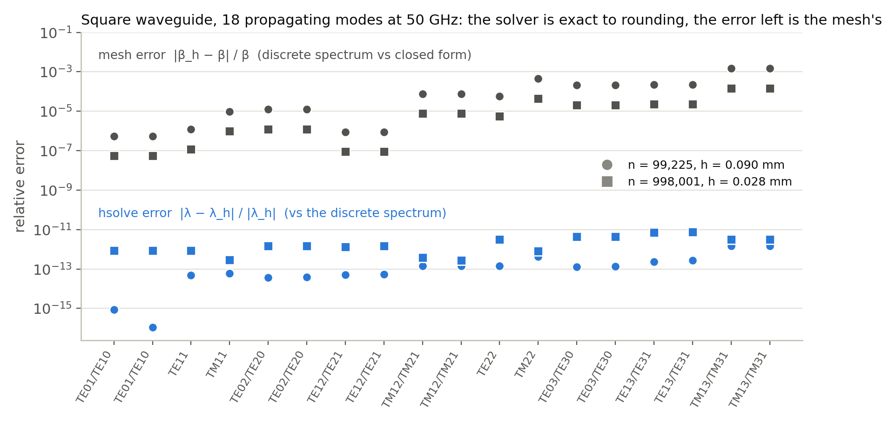

# 物理场景：谐振腔与波导

特征值本身只是数字；工程上关心的是谐振频率、传播常数和模式场分布。本页用两个有闭式解的经典电磁结构
检验 hsolve：矩形金属谐振腔（求谐振频率）和方形金属波导（求传播常数，A、B 都不定的广义问题）。
每个结果同时和两样东西比较：

- **离散精确值**——同一离散矩阵的特征值（Yee 网格的色散关系，或与求解器无关的分族参考解）。hsolve 与它的差就是
  **求解器误差**，应当停在舍入误差的量级。
- **解析解**——连续模型的闭式公式。离散精确值与它的差是**网格离散误差**，随网格加密按 h² 下降，与求解器无关。



## 矩形谐振腔

WR-90 波导截面（22.86 × 10.16 mm）两端封闭成 30 mm 长的金属腔，Yee 网格（有限积分法）离散，广义特征问题
A x = k² B x，谐振频率 f = c·k / 2π。旋度-旋度算子在 0 处有维数巨大的梯度零空间（非物理的静态场），
σ = 0 附近的普通位移反演会收敛到这些零模——这就是低频击穿。hsolve 用 `zero_filter_tol` 按 Sylvester 惯性把零带
整段切掉，再在零带之外求最近的 k 个，并给出完备性证书。

<!-- BEGIN GENERATED: cavity-facts -->
- 腔体 22.86 × 10.16 × 30.0 mm，Yee 网格 46 × 20 × 60（步长约 0.51 mm），n = 155,966，梯度零空间 50,445 维。
- 查询：σ = 0 附近的最低 10 个物理谐振（`zero_filter_tol` = 1e-08）；hsolve 按惯性排除了 50,445 个零模，证书 exact：计数 24、找到 24，通过。
- 独立评测：通过，完备性 complete（10/10），最大后向误差 1.8e-12。
<!-- END GENERATED: cavity-facts -->

<!-- BEGIN GENERATED: cavity-table -->
| 模式 | 简并 | 解析解 (GHz) | 离散精确值 (GHz) | hsolve (GHz) | hsolve 对离散精确值 | 离散化误差（频率） |
|---|---|---|---|---|---|---|
| TE101 | 1 | 8.243877 | 8.242518 | 8.242518 | 3.1e-14 | 0.02% |
| TE102 | 1 | 11.952313 | 11.947797 | 11.947797 | 1.5e-14 | 0.04% |
| TE201 | 1 | 14.033880 | 14.024152 | 14.024152 | 9.3e-15 | 0.07% |
| TE011 | 1 | 15.576685 | 15.562141 | 15.562141 | 8.6e-15 | 0.09% |
| TM110 | 1 | 16.145086 | 16.130713 | 16.130713 | 1.6e-14 | 0.09% |
| TE103 | 1 | 16.361078 | 16.346454 | 16.346454 | 7.3e-15 | 0.09% |
| TE202 | 1 | 16.487754 | 16.476881 | 16.476881 | 8.5e-15 | 0.07% |
| TE111/TM111 | 2 | 16.900569 | 16.886670 | 16.886670 | 1.5e-14 | 0.08% |
| TE012 | 1 | 17.819354 | 17.804240 | 17.804240 | 6.2e-15 | 0.08% |
<!-- END GENERATED: cavity-table -->

解析频率 f_mnp = (c/2)·√((m/a)² + (n/b)² + (p/d)²)；m、n、p 都 ≥ 1 时 TE_mnp 与 TM_mnp 简并（简并度 2），
hsolve 返回该二维特征空间的一组基。上图为非简并模式在中截面 y = b/2 上的 |E|，由特征向量的棱上分量平均到
网格单元中心得到（`tools/showcase/physics.py`）。

## 方波导：B 不定的广义问题

10 × 10 mm 空心金属方波导，工作频率 50 GHz，Lee-Sun-Cendes 有限元（Nédélec 棱元 + 节点元），特征值 λ = −β²。
A、B 都不定：B 的负特征值个数等于内部节点数；A 有同样维数的零空间（λ = 0 的非物理模，不是传播模）。
连续模型在 50 GHz 有 18 个传播模（TE₁₀/TE₀₁、TE₁₁、TM₁₁ …… 截止频率低于 50 GHz 的全部模式）。

<!-- BEGIN GENERATED: waveguide-convergence -->
| 算例 | n | 网格尺寸 h (mm) | 零簇维数 | B 的惯性（负/正） | 返回 | 评测 | hsolve 最大相对误差 | 最大离散化误差（β） |
|---|---|---|---|---|---|---|---|---|
| `wg-square-1e5` | 99,225 | 0.0895 | – | 24,649 / 74,576 | 18 个实模，复对 0 | 通过（complete） | 1.5e-12 | 1.48e-03 |
| `wg-square-1e6` | 998,001 | 0.0283 | – | 249,001 / 749,000 | 18 个实模，复对 0 | 通过（complete） | 7.7e-12 | 1.48e-04 |
<!-- END GENERATED: waveguide-convergence -->

n ≈ 1e5 时 18 个传播模的传播常数（离散参考来自 TE/TM 两族对称正定子问题，见
`tools/showcase/waveguide_ref.py`；解析值 β = √(k₀² − k_c²)，k_c² = (mπ/a)² + (nπ/b)²）：

<!-- BEGIN GENERATED: waveguide-table -->
| 模式 | 解析 β (rad/mm) | 离散参考 β | hsolve β | hsolve 对离散参考 | 离散化误差（β） |
|---|---|---|---|---|---|
| TE01/TE10 | 0.99972273 | 0.99972328 | 0.99972328 | 8.9e-16 | 5.42e-07 |
| TE01/TE10 | 0.99972273 | 0.99972328 | 0.99972328 | 1.1e-16 | 5.42e-07 |
| TE11 | 0.94907824 | 0.94907710 | 0.94907710 | 4.8e-14 | 1.20e-06 |
| TM11 | 0.94907824 | 0.94906910 | 0.94906910 | 5.9e-14 | 9.63e-06 |
| TE02/TE20 | 0.83866406 | 0.83867440 | 0.83867440 | 3.8e-14 | 1.23e-05 |
| TE02/TE20 | 0.83866406 | 0.83867440 | 0.83867440 | 3.8e-14 | 1.23e-05 |
| TE12/TE21 | 0.77759975 | 0.77760045 | 0.77760045 | 5.0e-14 | 8.98e-07 |
| TE12/TE21 | 0.77759975 | 0.77760045 | 0.77760045 | 5.5e-14 | 8.98e-07 |
| TM12/TM21 | 0.77759975 | 0.77753946 | 0.77753946 | 1.4e-13 | 7.75e-05 |
| TM12/TM21 | 0.77759975 | 0.77753946 | 0.77753946 | 1.4e-13 | 7.75e-05 |
| TE22 | 0.55549369 | 0.55546248 | 0.55546248 | 1.5e-13 | 5.62e-05 |
| TM22 | 0.55549369 | 0.55524385 | 0.55524385 | 4.3e-13 | 4.50e-04 |
| TE03/TE30 | 0.45812356 | 0.45821937 | 0.45821937 | 1.3e-13 | 2.09e-04 |
| TE03/TE30 | 0.45812356 | 0.45821937 | 0.45821937 | 1.3e-13 | 2.09e-04 |
| TE13/TE31 | 0.33343837 | 0.33351314 | 0.33351314 | 2.4e-13 | 2.24e-04 |
| TE13/TE31 | 0.33343837 | 0.33351314 | 0.33351314 | 2.8e-13 | 2.24e-04 |
| TM13/TM31 | 0.33343837 | 0.33294384 | 0.33294384 | 1.5e-12 | 1.48e-03 |
| TM13/TM31 | 0.33343837 | 0.33294384 | 0.33294384 | 1.5e-12 | 1.48e-03 |
<!-- END GENERATED: waveguide-table -->


求解器误差与离散误差分开看：hsolve 相对离散精确值的误差在两种网格上都停在舍入量级，离散误差则随网格加密
按 h² 下降——精度瓶颈在网格，不在求解器。



**伪模与不定性的处理**：B 不定时没有 B-内积，Lanczos 类方法不再适用；hsolve 走一般 Krylov-Schur（GHIEP 路径）。
零簇（λ = 0 的非物理模）从不作为答案：σ 处的普通运行若有特征值落入零带，hsolve 数 A 的零主元得出零簇维数，
改用零带两侧的单边位移，让零簇落在不需要的一侧（`docs/DESIGN.md` §3.6-9）。本例 σ 处的 18 个最近特征值都离零带
足够远，普通运行即得到全部传播模（表中零簇维数为「–」即未触发）；返回的都是实传播模，没有 λ = 0 的伪模，
也没有复数伪对（表中「复对 0」）。B 不定时 Sylvester 计数给不出完备性证书（报告中注明），完整性由与求解器无关的
分族参考解独立验证（参考谱同时列出零簇，评测因此能确认 18 个最近的都是传播模）。

## 复现

```bash
tools/showcase/run_all.sh prepare        # 方波导的分族参考解（与困难场景对比共用数据根）
tools/showcase/run_all.sh physics        # 腔体算例生成、hsolve 求解、独立评测、模式场采样
python -m tools.showcase.tables          # 本页表格（results/showcase/physics/*.json）
HS_FIGURE_PYTHON=/path/to/python-with-matplotlib \
  tools/showcase/run_all.sh figures cavity_modes waveguide_modes waveguide_errors
```

结果文件：[`results/showcase/physics/cavity.json`](../../results/showcase/physics/cavity.json)、
[`waveguide.json`](../../results/showcase/physics/waveguide.json)，模式场采样 `*_modes.npz`。
这些运行在构建/测试道（8 线程）上完成，只用于精度比较，耗时不作为性能数据。图中的数字（频率、β、误差）
都由作图脚本从上述 JSON 读出。

## 说明与局限

两个结构都是均匀填充的规则几何，选它们正是因为有闭式解：离散精确值把求解器误差和网格误差干净地分开。
介质加载的波导（半填充，εr = 2.25）、SuiteSparse 的实际电磁矩阵等没有闭式解的问题见
[困难场景对比](困难场景对比.md)。腔体的网格步长约 0.5 mm，波导 1e5 / 1e6 两档网格；表中的离散误差是这些网格
本身的精度，不代表求解器精度。模式场图由棱上分量平均到单元中心，不是高阶后处理。
